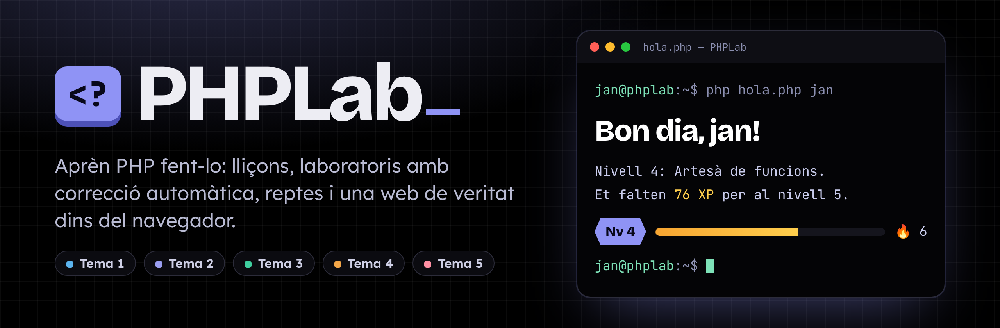
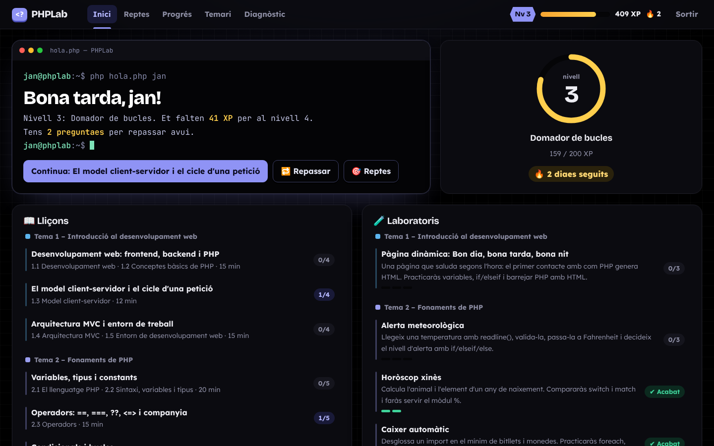
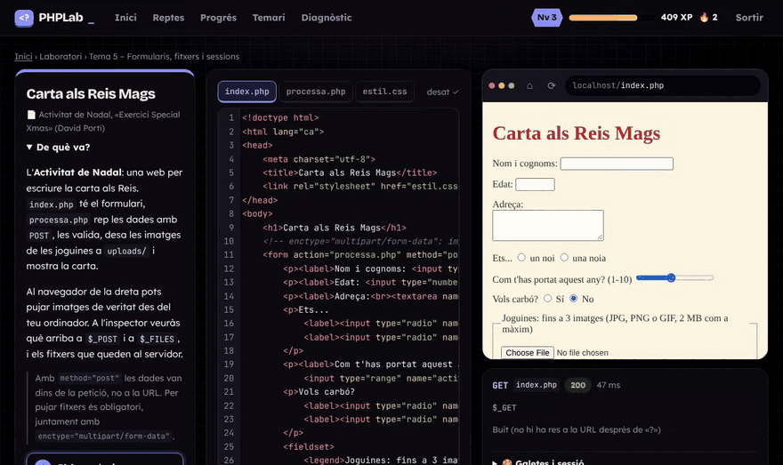
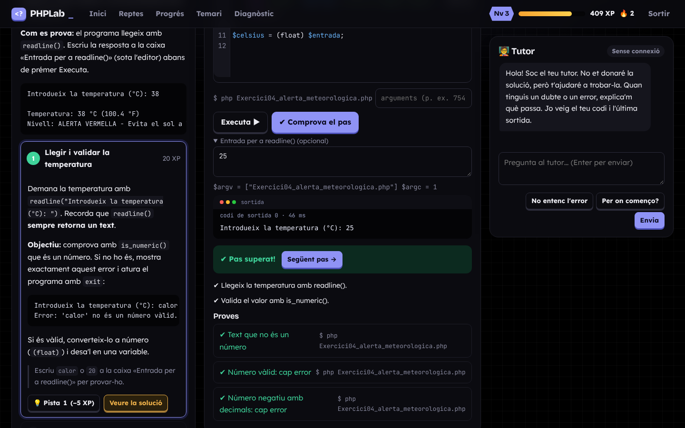
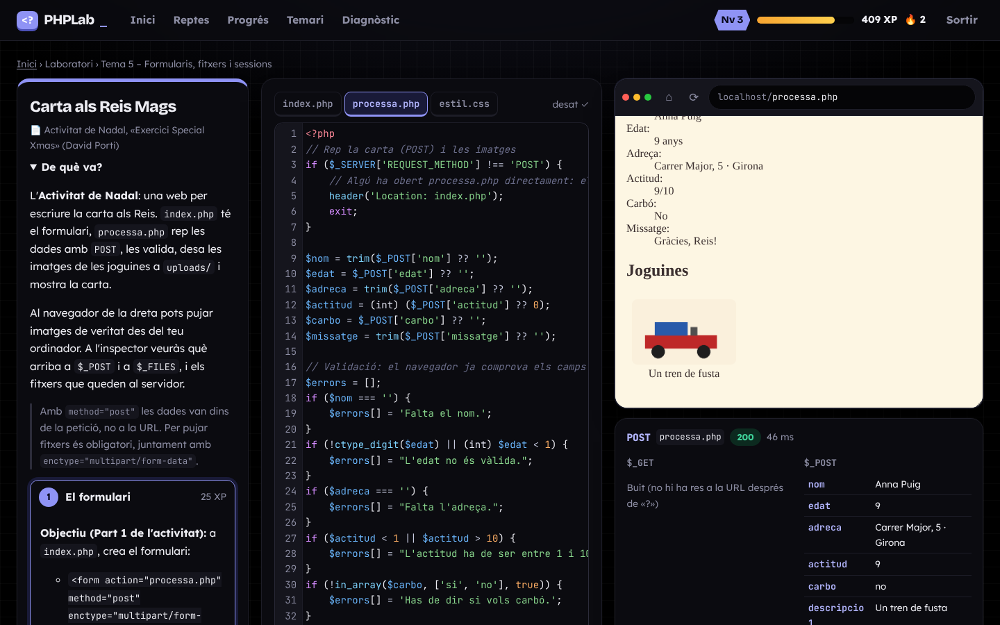
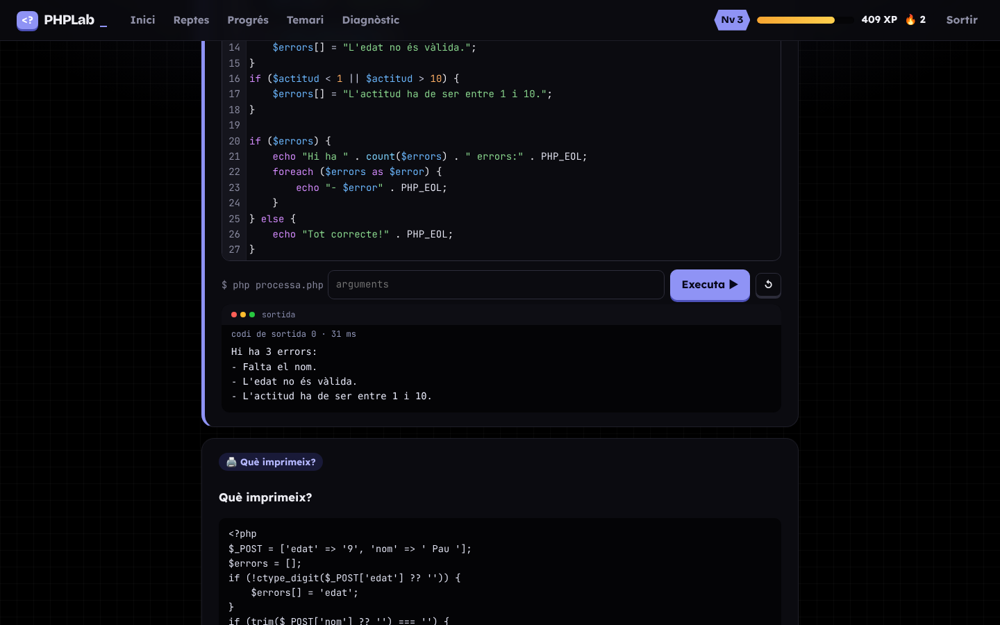
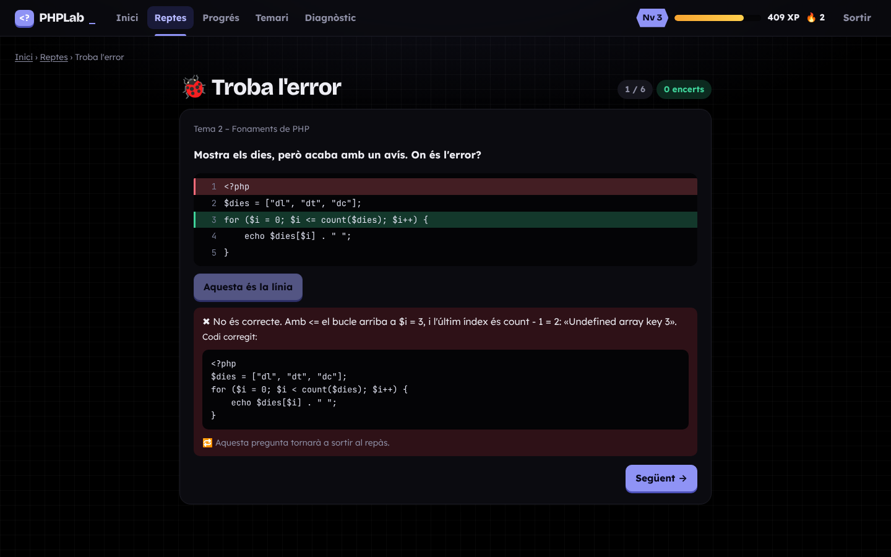
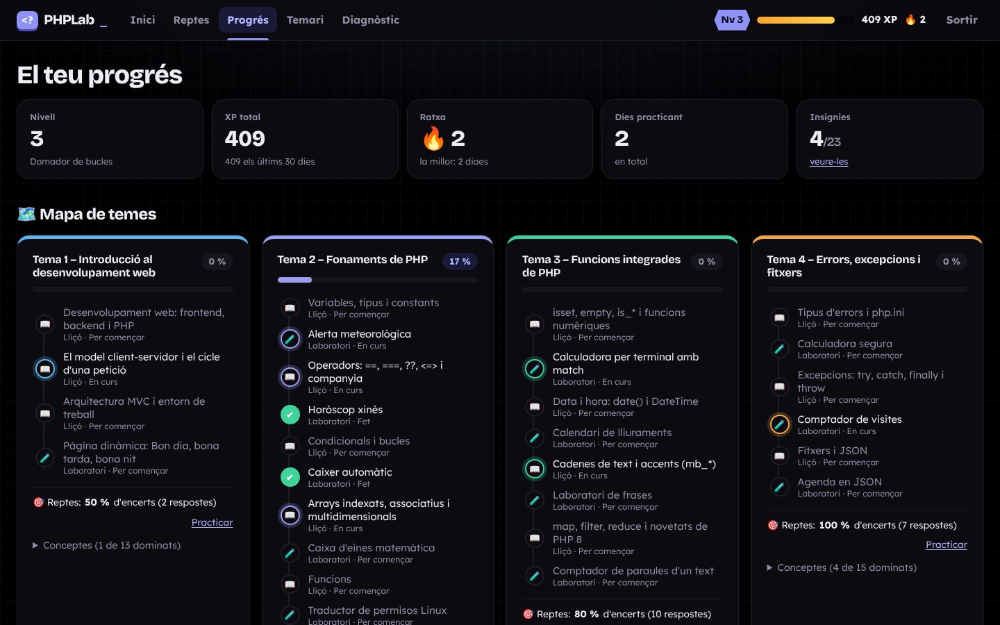
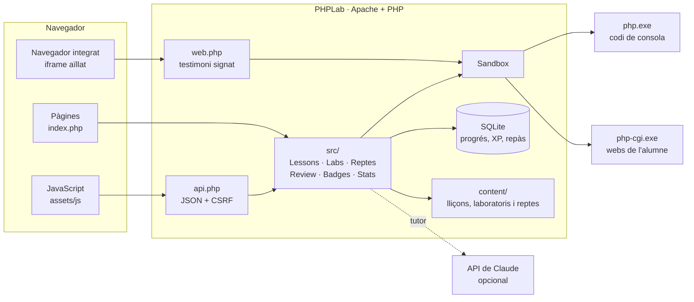
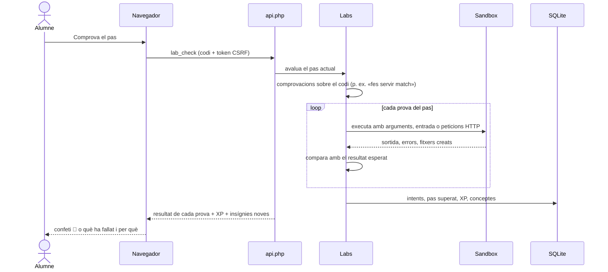

<p align="center">
  
</p>

<p align="center">
  
  
  
  
  
</p>

<p align="center">
  <b>Una app web per aprendre PHP a partir del temari de classe</b><br>
  M0376 · Implantació d'aplicacions web · ASIX2<br>
  <a href="#que-hi-ha">Què hi ha</a> ·
  <a href="#com-funciona">Com funciona</a> ·
  <a href="#seguretat">Seguretat</a> ·
  <a href="#installacio">Instal·lació</a> ·
  <a href="docs/GUIA.md">Guia completa</a>
</p>

---

**PHPLab** converteix els apunts i els exercicis de classe en lliçons interactives, laboratoris amb correcció automàtica,
reptes i repàs espaciat. Tot el codi que escrius s'executa de veritat al teu PC, en un *sandbox* aïllat, i la teva web
de formularis s'obre en un navegador integrat on pots veure què rep PHP a cada petició.

L'aplicació està feta en **PHP 8 pur, sense framework**, perquè també serveixi d'exemple: el codi està comentat en català i
es pot llegir de dalt a baix.

<p align="center">
  
</p>

<a id="que-hi-ha"></a>

## ✨ Què hi ha

<table>
  <tr>
    <td width="50%" valign="top">
      <h3>📖 Lliçons</h3>
      <p><b>19 lliçons</b> dels Temes 1 a 5, amb exemples «Prova-ho» que pots editar i executar, i preguntes de quatre tipus:
      test, completa el codi, «què imprimeix?» i ordena les línies. La correcció es fa sempre al servidor.</p>
    </td>
    <td width="50%" valign="top">
      <h3>🧪 Laboratoris</h3>
      <p><b>17 exercicis guiats</b> pas a pas, basats en els exercicis de classe. Cada pas té proves automàtiques, pistes
      de 3 nivells, la solució després de 3 intents i un tutor que t'ajuda sense donar-te la resposta.</p>
    </td>
  </tr>
  <tr>
    <td valign="top">
      <h3>🌐 Laboratoris web</h3>
      <p>Escrius <code>index.php</code>, <code>processa.php</code> i <code>estil.css</code> i els proves en un <b>navegador integrat</b>:
      formularis GET i POST, pujada d'imatges, redireccions i sessions. L'inspector et mostra <code>$_GET</code>, <code>$_POST</code>,
      <code>$_FILES</code>, les galetes i <code>$_SESSION</code>.</p>
    </td>
    <td valign="top">
      <h3>🎯 Reptes i repàs</h3>
      <p><b>59 reptes</b> en quatre modes: contrarellotge, «Troba l'error» (amb errates reals del temari), «Què imprimeix?» i «Ordena el codi».
      El que falles torna al <b>repàs espaciat</b> (sistema Leitner: 1, 3, 7, 14 i 30 dies).</p>
    </td>
  </tr>
  <tr>
    <td valign="top">
      <h3>🗺️ Progrés</h3>
      <p>Mapa de temes amb el domini de cada concepte, <b>23 insígnies</b>, XP, nivells, ratxa de dies i estadístiques.
      Confeti quan encertes i una pantalla especial quan puges de nivell.</p>
    </td>
    <td valign="top">
      <h3>📚 Temari</h3>
      <p>Puges els PDF, ZIP o DOCX de classe i la app els indexa per temes, detecta els canvis i et deixa llegir-los.
      Les lliçons citen la pàgina d'on surt cada explicació.</p>
    </td>
  </tr>
</table>

### El navegador integrat

La **Carta als Reis Mags** (l'Activitat de Nadal): omples el formulari, puges la imatge d'una joguina i PHP la desa a `uploads/`.
A sota, l'inspector mostra què ha arribat a `$_POST` i a `$_FILES`.

<p align="center">
  
</p>

### Més captures

<table>
  <tr>
    <td width="50%"><br><sub><b>Laboratori de consola</b>: editor, entrada per a <code>readline()</code>, proves i tutor.</sub></td>
    <td width="50%"><br><sub><b>Laboratori web</b>: pestanyes de fitxers, navegador i inspector.</sub></td>
  </tr>
  <tr>
    <td><br><sub><b>Lliçó</b>: un exemple «Prova-ho» executat.</sub></td>
    <td><br><sub><b>Troba l'error</b>: la línia bona en verd i el codi corregit.</sub></td>
  </tr>
  <tr>
    <td colspan="2"><br><sub><b>Progrés</b>: mapa de temes, conceptes dominats i insígnies.</sub></td>
  </tr>
</table>

### Contingut per tema

| Tema | Lliçons | Laboratoris | Reptes |
|---|---|---|:---:|
| 🟦 **1 · Introducció al desenvolupament web** | Frontend i backend · Client-servidor · MVC i entorn | Pàgina dinàmica (Bon dia, bona tarda, bona nit) | 7 |
| 🟪 **2 · Fonaments de PHP** | Variables · Operadors · Condicionals i bucles · Arrays · Funcions · `$argv` i `$argc` | Alerta meteorològica · Horòscop xinès · Caixer automàtic · Caixa d'eines matemàtica · Permisos Linux · Còpia de seguretat | 17 |
| 🟩 **3 · Funcions integrades** | `isset`/`empty` · Dates · Cadenes i `mb_*` · `map`, `filter`, `reduce` | Calculadora amb `match` · Calendari de lliuraments · Frases · Comptador de paraules | 14 |
| 🟧 **4 · Errors, excepcions i fitxers** | Errors i `php.ini` · Excepcions · Fitxers i JSON | Calculadora segura · Comptador de visites · Agenda en JSON | 11 |
| 🟥 **5 · Formularis, fitxers i sessions** | GET i POST · Pujar fitxers · Galetes i sessions | 🌐 Salutació amb GET · 🌐 Carta als Reis Mags · 🌐 Zona privada amb sessions | 10 |

Els laboratoris surten dels enunciats de classe (Exercicis 01 i 02, les activitats de cada tema i l'Activitat de Nadal).
Quan un contingut no és del temari de classe, la app el marca com a **ampliació**.

<a id="com-funciona"></a>

## ⚙️ Com funciona



- **El contingut és codi PHP.** Cada lliçó, laboratori i repte és un fitxer de `content/` que retorna un array: text, exemples,
  preguntes, passos, proves i pistes. Afegir-ne un de nou vol dir afegir-hi un fitxer.
- **Tot es corregeix al servidor.** El navegador no rep mai les respostes correctes. Les preguntes es comproven a PHP i
  els laboratoris s'executen de veritat.
- **El sandbox** executa el teu codi en un procés PHP separat amb límits de temps, memòria i carpeta (mira [Seguretat](#seguretat)).
- **Els laboratoris web** fan servir `php-cgi.exe`, el mateix mecanisme que usa un servidor web real. Així `$_POST`, `$_FILES`,
  `header('Location: ...')` i les sessions funcionen igual que a XAMPP.

### Què passa quan prems «Comprova el pas»



Els errors de PHP («Undefined array key», «Unsupported operand types»...) es tradueixen a explicacions en català
amb la línia on passen.

### El tutor

Cada laboratori té un tutor socràtic: et fa preguntes i et dona pistes, però no t'escriu la solució.
Amb una clau de l'API de Claude respon amb IA (amb límits diaris de peticions i de tokens). Sense clau, funciona en
**mode sense connexió**, amb pistes i preguntes preparades per a cada pas.

<a id="seguretat"></a>

## 🔒 Seguretat

La app està pensada per a ús personal **a la xarxa de casa**, no per publicar-la a Internet.

| | Mesura |
|---|---|
| **Accés** | Només des de `localhost` i la xarxa local (`.htaccess` i comprovació a PHP). Un sol usuari amb `password_hash()`, bloqueig després de 5 intents, sessió `HttpOnly` i `SameSite=Strict`, i token CSRF a totes les accions. |
| **Sandbox** | Procés separat, 5 s de temps màxim, 64 MB de memòria, `open_basedir` a la carpeta del laboratori, funcions perilloses desactivades (`exec`, `system`, sockets, `curl`, `ini_set`...), sense `allow_url_fopen` i com a molt 2 execucions alhora. |
| **Laboratoris web** | La teva web s'obre en un iframe amb `sandbox` i amb la capçalera `Content-Security-Policy: sandbox`: el seu JavaScript no pot llegir res de PHPLab. L'adreça porta un testimoni signat que caduca. Les galetes i les sessions de la teva web es guarden a part. |
| **Temari pujat** | Es guarda fora de `htdocs`, amb protecció contra *zip slip* i *zip bomb*, i sense duplicats (hash SHA-256). |
| **Clau de l'API** | A `config.php`, que no es puja mai al repositori i no arriba mai al navegador. |

Els detalls de cada mesura, i per què hi és, són a la [guia completa](docs/GUIA.md#4-seguretat-què-fa-la-app-i-per-què).

<a id="installacio"></a>

## 🚀 Instal·lació ràpida

Necessites **XAMPP** (PHP 8.2 o superior) a Windows. A la [guia completa](docs/GUIA.md) hi ha cada pas explicat, amb captures
dels problemes més habituals.

```bat
:: 1. Descarrega el projecte dins de htdocs
cd C:\xampp\htdocs
git clone https://github.com/jaanboote/php.git phplab
cd phplab

:: 2. Instal·la les dependències (lectura de PDF i SDK de Claude)
composer install

:: 3. Crea la configuració
copy config.example.php config.php
```

4. Activa `extension=zip` a `C:\xampp\php\php.ini` i reinicia Apache.
5. Obre **http://localhost/phplab**, crea el teu usuari i ves a **Diagnòstic**: totes les línies han d'estar en verd
   (la clau de l'API és opcional).

Per actualitzar a una versió nova: `git pull` a la carpeta del projecte i recarregar amb **Ctrl+F5**.
Les migracions de la base de dades s'apliquen soles.

## 🗂️ Estructura

```text
phplab/
├── index.php            Pàgines (inici, lliçó, laboratori, reptes, progrés, temari...)
├── api.php              Accions en JSON per al JavaScript (executar, corregir, pistes, tutor...)
├── web.php              Navegador integrat dels laboratoris web
├── src/                 Lògica: Sandbox, Labs, WebLab, Lessons, Reptes, Review, Badges, Stats, Tutor, Indexer...
├── templates/           Vistes PHP (una per pàgina)
├── content/
│   ├── lessons/         Una lliçó per fitxer
│   ├── labs/            Un laboratori per fitxer (de consola o web)
│   └── reptes/          Banc de reptes per tema
├── assets/              CSS, JavaScript, CodeMirror i fonts (tot local: funciona sense Internet)
├── eines/               verifica-contingut.php i canvia-contrasenya.php
└── docs/                Guia completa i imatges d'aquest README
```

Les dades (base de dades SQLite, temari pujat i carpetes del sandbox) es guarden **fora de `htdocs`**, a `C:\xampp\phplab-data`.

## ✍️ Afegir contingut

1. Copia un fitxer semblant de `content/lessons/`, `content/labs/` o `content/reptes/` i canvia'n el contingut.
2. Comprova-ho tot:

   ```bat
   C:\xampp\php\php.exe eines\verifica-contingut.php
   ```

   L'eina executa tots els exemples i comprova cada laboratori:
   - que la solució de cada pas supera les seves proves;
   - que la solució del pas anterior **no** les supera (si les superés, les proves no comprovarien res de nou).

   També comprova les respostes de «Què imprimeix?» i, a «Troba l'error», que la línia marcada sigui la que canvia
   entre el codi erroni i el corregit. Al final ha de sortir **«Tot correcte.»**

## 🧰 Tecnologies

| | |
|---|---|
| **Servidor** | PHP 8.2 sense framework · PDO SQLite amb migracions · Apache (XAMPP) |
| **Execució del codi** | `proc_open` amb `php.exe` (consola) i `php-cgi.exe` (web) |
| **Interfície** | HTML i CSS propis, JavaScript sense dependències · CodeMirror 5 · fonts Bricolage Grotesque, Lexend i JetBrains Mono |
| **Temari** | `smalot/pdfparser` (PDF) · `ZipArchive` (ZIP i DOCX) |
| **Tutor (opcional)** | SDK oficial de PHP de l'API de Claude |

## 🙏 Crèdits

- Temari, exercicis i Activitat de Nadal: **prof. David Porti**, mòdul M0376 d'ASIX2. Aquest repositori no inclou els PDF de classe:
  cadascú puja els seus.
- [CodeMirror](https://codemirror.net/5/) (MIT) i les fonts [Bricolage Grotesque](https://github.com/ateliertriay/bricolage),
  [Lexend](https://www.lexend.com/) i [JetBrains Mono](https://www.jetbrains.com/lp/mono/) (SIL Open Font License).
